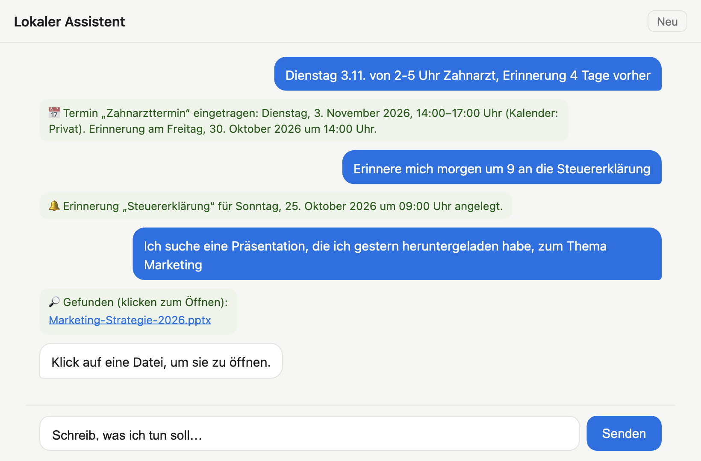

# Local Assistant

A small, private AI assistant for macOS that runs entirely on your own machine. You give it instructions in plain German, the way you would jot a note to yourself, and it does the work for you: it adds appointments to your calendar, sets reminders, and finds files you have lost track of.

Nothing you type leaves your computer. There is no cloud service, account or subscription. The only time it needs the internet is a one-off download of the language model.



> **Note:** This is a personal project built for private use. The interface and the language it understands are German. This README is in English so the project is accessible to a wider audience.

---

## What it can do

The assistant understands German, so the examples below are given as you would actually type them, followed by a translation.

| You type… | It does… |
|---|---|
| *„Dienstag 27. von 2–5 Uhr Zahnarzt, Erinnerung 4 Tage vorher“*<br><sub>“Tuesday 27th, 2 to 5, dentist, remind me 4 days before”</sub> | Adds a dentist appointment to Calendar on Tuesday the 27th from 14:00 to 17:00, with an alert four days before. |
| *„Erinnere mich morgen um 9 an die Steuererklärung“*<br><sub>“Remind me about my tax return tomorrow at 9”</sub> | Creates a reminder in the Reminders app for 09:00 tomorrow. |
| *„Ich suche eine Präsentation, die ich gestern heruntergeladen habe, zum Thema Marketing“*<br><sub>“I'm looking for a presentation on marketing that I downloaded yesterday”</sub> | Searches your Downloads folder for presentations from the last two days that mention marketing, and lists them. One click opens a file. |

It also notices when you have made a slip. If you write *“Tuesday the 23rd”* and the 23rd is actually a Friday, it won't guess. It asks whether you meant Friday the 23rd or Tuesday the 27th.

---

## How it works

The design rests on one idea: **let the language model do what it is good at, and leave the rest to ordinary code.**

Small language models are surprisingly capable at working out *what* someone wants. They are much less reliable with dates, times and arithmetic. In testing, the model would regularly turn “2 o'clock” into 02:00 instead of 14:00, or put “tomorrow” on today. So the work is split in two:

1. **Rule-based parsing (Python).** Before the model sees anything, a set of regular expressions picks out dates (“morgen”, “Dienstag 23.”, “3.11.”), time ranges (“von 2–5 Uhr”), reminder offsets (“4 Tage vorher”) and search filters (“gestern”, “Präsentation”, “heruntergeladen”). Whatever the rules recognise with confidence overrides the model's interpretation.
2. **The language model (via Ollama).** The model decides which action to take and writes the title and the reply. It talks to the rest of the program through *tool calling*: it asks for an action, the program carries it out, and the program reports the result back.

The actions themselves use built-in macOS features:

- **Calendar and Reminders** are driven through AppleScript.
- **File search** uses Spotlight (`mdfind`), so even large drives are searched almost instantly, including the text inside documents.

```
 Browser chat ──► Python server ──► rule-based parser ──┐
                        │                                ▼
                        └──────► Ollama (qwen2.5:3b) ──► tools ──► Calendar / Reminders / Spotlight
```

---

## Built to be light

- **No dependencies.** The server uses only the Python standard library that ships with macOS. There is no `pip install` step.
- **A small model.** `qwen2.5:3b` takes up about 2 GB on disk and 2–3 GB of memory while it is answering.
- **Unloads when idle.** After five minutes without use, the model is removed from memory automatically.
- **Hardware-aware.** On virtual machines, whose virtual GPU is often far slower than the CPU, the assistant switches to CPU inference automatically. In testing, this made it roughly ten times faster: typical replies take 5–20 seconds instead of minutes.

---

## Getting started

**Requirements:** macOS and [Ollama](https://ollama.com/download).

1. Install Ollama.
2. Double-click `start.command`. The first time you do this, it downloads the model (about 2 GB). After that it starts within seconds.
3. The chat opens in your browser at `http://127.0.0.1:8765`.
4. The first time it touches Calendar or Reminders, macOS asks for permission. Click **Allow**.

To start it from the terminal instead:

```bash
./start.command
```

---

## Configuration

Settings are optional and are passed as environment variables:

| Variable | Default | Purpose |
|---|---|---|
| `ASSISTENT_MODEL` | `qwen2.5:3b` | Any Ollama model that supports tool calling. Use `qwen2.5:1.5b` on modest hardware. |
| `ASSISTENT_KALENDER` | first writable calendar | Name of the calendar to add appointments to. |
| `ASSISTENT_GPU` | `auto` | `auto`, `an` (on) or `aus` (off). |
| `ASSISTENT_PORT` | `8765` | Port for the web interface. |
| `ASSISTENT_TESTLAUF` | off | Set to `1` for a dry run: the assistant behaves as usual but leaves Calendar and Reminders untouched. Handy for demos. |

Example:

```bash
ASSISTENT_MODEL=qwen2.5:1.5b ./start.command
```

---

## Privacy and security

- The web server listens only on `127.0.0.1`, so other devices on your network cannot reach it.
- It rejects requests that come from other websites, so a page open in another tab cannot use it.
- It will only open files inside your home folder.
- The conversation is held in memory and is gone when you stop the program.

---

## Project structure

```
assistent.py     Server, rule-based parser, tools and Ollama integration
index.html       Chat interface (plain HTML/CSS/JS, light and dark mode)
start.command    One-click launcher: starts Ollama, fetches the model, opens the browser
docs/            Screenshot for this README
```

---

## Ideas for the future

- Natural-language queries about existing appointments (“What have I got on Friday?”)
- Support for English input
- A menu-bar app instead of a browser tab
